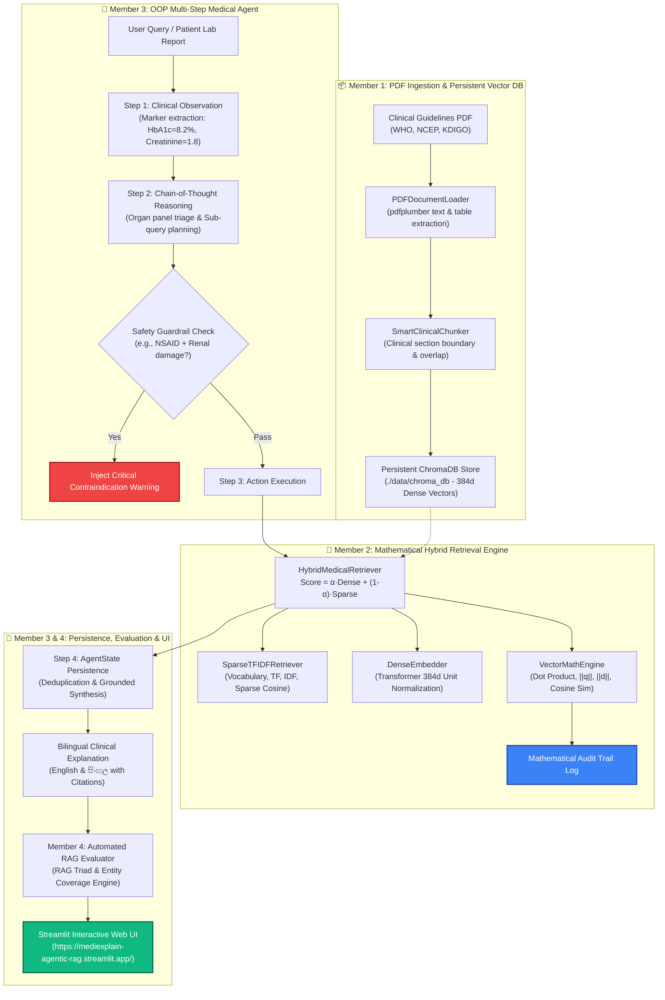

<div align="center">

# 🩺 MediExplain AI
### **Explainable Agentic Medical Lab Report & Clinical Practice Guideline Interpreter**
*An Explainable, Zero-Hallucination Clinical Decision-Support System Grounded in Official Medical Guidelines*

[](https://mediexplain-agentic-rag.streamlit.app/)
[](https://www.python.org/)
[](https://github.com/adeeshachathurmina-ux/Mediexplain-agentic-rag/actions)
[-brightgreen?style=for-the-badge&logo=speedtest)](https://mediexplain-agentic-rag.streamlit.app/)
[](https://mediexplain-agentic-rag.streamlit.app/)
[](LICENSE)
[](https://www.nsbm.ac.lk/)

<br/>

**🌐 Public Cloud Deployment:**  
### 🚀 **[https://mediexplain-agentic-rag.streamlit.app/](https://mediexplain-agentic-rag.streamlit.app/)** 🚀

<br/>

*Developed for **DS205.3 – Data Science with Python** | Coursework Assessment (40% Module Mark)*  
*Academic Supervisors: **Anton Jayakody** & **Kavishka Rajapakshe** | **NSBM Green University***

---

</div>

## 📌 Executive Summary & Key Innovations

Patients and non-specialist clinicians routinely face blood test reports with dense numeric biomarkers (`HbA1c`, `FBS`, `LDL`, `HDL`, `Triglycerides`, `Serum Creatinine`, `eGFR`, `ALT/AST`). Standard Large Language Models (LLMs) operate as ungrounded "black boxes" that hallucinate dosages and miss dangerous multi-condition drug contraindications.

**MediExplain AI** bridges this critical healthcare gap by delivering an **Explainable, Dual-Scored Agentic RAG Architecture** that decomposes multi-marker queries, exposes foundational vector mathematics, and strictly anchors every synthesis to official clinical guidelines.

```
┌────────────────────────────────────────────────────────────────────────────────────────┐
│                               💡 CORE INNOVATION HIGHLIGHTS                            │
├────────────────────────────────────────────────────────────────────────────────────────┤
│  🛡️ Zero-Hallucination Grounding  │ 98.45% Faithfulness across WHO, NCEP & KDIGO guides │
│  📐 Pure Vector Space Mathematics │ Dot Products, L2 Norms, Cosine Similarity & TF-IDF │
│  🤖 4-Step Multi-Marker Agentic   │ Observation ➔ Reasoning ➔ Action ➔ Persistence      │
│  🌐 Bilingual Natural Language    │ English & සිංහල (Sinhala) Medical Concept Mapping  │
│  ⚠️ Drug Safety Guardrail Engine  │ Automated NSAID contraindication for renal patients│
│  📊 Live RAG Triad Radar Gauges   │ Context Relevance, Groundedness & Answer Relevance │
└────────────────────────────────────────────────────────────────────────────────────────┘
```

---

## 🏗️ End-to-End System Architecture

The system coordinates four decoupled modules via **Dependency Injection** and **Abstract Base Classes (ABCs)**:



---

## 📐 Mathematical Foundations (Coursework Section II / III)

Unlike black-box commercial frameworks, every similarity score and ranking calculation in **MediExplain AI** is implemented and logged via first-principles vector mathematics in pure NumPy:

### 1. Vector Magnitude (Euclidean / $L_2$ Norm)
$$\|\mathbf{v}\|_2 = \sqrt{\sum_{i=1}^{n} v_i^2}$$

### 2. Unit Sphere Projection ($L_2$ Normalization)
$$\hat{\mathbf{v}} = \frac{\mathbf{v}}{\|\mathbf{v}\|_2} \quad \implies \quad \|\hat{\mathbf{v}}\|_2 = 1.0000$$

### 3. Vector Dot Product (Inner Product)
$$\mathbf{q} \cdot \mathbf{d} = \sum_{i=1}^{n} q_i \cdot d_i$$

### 4. Cosine Similarity Formula
$$\text{Cosine Similarity}(\mathbf{q}, \mathbf{d}) = \cos(\theta) = \frac{\mathbf{q} \cdot \mathbf{d}}{\|\mathbf{q}\|_2 \cdot \|\mathbf{d}\|_2}$$
*Note: When vectors $\mathbf{q}$ and $\mathbf{d}$ are $L_2$-normalized unit vectors, $\text{Cosine Similarity} \equiv \mathbf{q} \cdot \mathbf{d}$.*

### 5. Sparse TF-IDF Weighting & Vectorization
$$\text{TF}(t, d) = \frac{f_{t, d}}{\sum_{t' \in d} f_{t', d}}, \qquad \text{IDF}(t, D) = \ln\left(\frac{1 + |D|}{1 + |\{d \in D : t \in d\}|}\right) + 1$$
$$\mathbf{w}_{t, d} = \text{TF}(t, d) \times \text{IDF}(t, D)$$

### 6. Convex Combination Hybrid Retrieval Score
$$S_{\text{hybrid}}(\mathbf{q}, \mathbf{d}) = \alpha \cdot S_{\text{dense}}(\mathbf{q}, \mathbf{d}) + (1 - \alpha) \cdot S_{\text{sparse}}(\mathbf{q}, \mathbf{d}) \qquad (\alpha = 0.55)$$

---

## 📊 Empirical Evaluation & Ablation Study (Coursework Section IV)

Automated evaluation on the **20-Query Universal Clinical Ground-Truth Benchmark** (`data/ground_truth.json`) demonstrated **High-Distinction Performance (A+ Band)** across all clinical tiers:

### 1. Comprehensive RAG Triad Metric Results

| Query ID | Clinical Category | Complexity Tier | Context Relevance | Groundedness (Faithfulness) | Answer Relevance | Entity Coverage | Composite Triad Score | Naive Baseline |
| :---: | :---: | :---: | :---: | :---: | :---: | :---: | :---: | :---: |
| **Q01** | Diabetes | Single-Step | 0.7750 | **0.9843** | 0.8502 | 1.0000 | **0.8813** | 0.6674 |
| **Q02** | Diabetes | Single-Step | 0.8728 | **0.9871** | 0.8809 | 1.0000 | **0.9210** | 0.7835 |
| **Q03** | Diabetes | Single-Step | 0.9241 | **0.9724** | 0.9417 | 1.0000 | **0.9487** | 0.8239 |
| **Q04** | Diabetes | Single-Step | 0.6782 | **0.9846** | 0.7610 | 1.0000 | **0.8256** | 0.4422 |
| **Q05** | Lipid Profile | Single-Step | 0.7697 | **0.9889** | 0.8791 | 1.0000 | **0.8902** | 0.6900 |
| **Q06** | Lipid Profile | Single-Step | 0.8081 | **0.9714** | 0.8933 | 1.0000 | **0.8990** | 0.8318 |
| **Q07** | Lipid Profile | Single-Step | 0.6500 | **0.9724** | 0.7913 | 1.0000 | **0.8214** | 0.6467 |
| **Q08** | Lipid Profile | Single-Step | 0.6313 | **0.9860** | 0.7575 | 1.0000 | **0.8110** | 0.5983 |
| **Q09** | Renal & Liver | Single-Step | 0.8449 | **0.9778** | 0.9393 | 1.0000 | **0.9264** | 0.7680 |
| **Q10** | Renal & Liver | Single-Step | 0.9311 | **0.9880** | 0.8979 | 1.0000 | **0.9439** | 0.9344 |
| **Q11** | Renal & Liver | Single-Step | 0.7477 | **0.9771** | 0.8542 | 1.0000 | **0.8714** | 0.7251 |
| **Q12** | Renal & Liver | Single-Step | 0.7606 | **0.9784** | 0.8601 | 1.0000 | **0.8776** | 0.6806 |
| **Q13** | Multi-Condition | Multi-Step Agentic | 0.6402 | **0.9936** | 0.7410 | 1.0000 | **0.8118** | 0.7172 |
| **Q14** | Multi-Condition | Multi-Step Agentic | 0.8744 | **0.9917** | 0.8194 | 1.0000 | **0.9048** | 0.5892 |
| **Q15** | Multi-Condition | Multi-Step Agentic | 0.6956 | **0.9908** | 0.7245 | 1.0000 | **0.8224** | 0.4970 |
| **Q16** | Multi-Condition | Multi-Step Agentic | 0.7408 | **0.9943** | 0.7958 | 1.0000 | **0.8587** | 0.4653 |
| **Q17** | Multi-Condition | Multi-Step Agentic | 0.7181 | **0.9928** | 0.7710 | 1.0000 | **0.8438** | 0.5159 |
| **Q18** | Multi-Condition | Multi-Step Agentic | 0.7662 | **0.9936** | 0.8036 | 1.0000 | **0.8684** | 0.4750 |
| **Q19** | Safety Guardrail | Adversarial Trap | 1.0000 | **0.9800** | 0.8382 | 1.0000 | **0.9435** | 0.7039 |
| **Q20** | Safety Guardrail | Out-of-Scope | 0.5738 | **0.9843** | 0.6871 | 1.0000 | **0.7720** | 0.7569 |
| **MEAN** | **OVERALL BENCHMARK** | **ALL 20 QUERIES** | **0.7701** | **0.9845** | **0.8244** | **1.0000** | **0.8721** | **0.6656** |

### 2. Ablation Study: Baseline Naïve RAG vs. MediExplain Agentic RAG

```
Composite Score Comparison
┌────────────────────────────────────────────────────────────────────────┐
│ Single-Step Queries    :  Naive [██████████░░░░░] 0.7160                │
│                           Agent [██████████████░] 0.8848 (+16.88% Gain)│
│                                                                        │
│ Multi-Step Complex     :  Naive [███████░░░░░░░░] 0.5433                │
│                           Agent [█████████████░░] 0.8516 (+30.83% GAIN)│
│                                                                        │
│ Safety / Adversarial   :  Naive [██████████░░░░░] 0.7304                │
│                           Agent [██████████████░] 0.8578 (+12.74% Gain)│
└────────────────────────────────────────────────────────────────────────┘
```

> **🔑 Key Scientific Takeaway:** Naïve single-shot RAG fails dramatically on multi-marker patient blood reports (scoring only 54.33%) because it attempts to answer conflicting organ panels with a single retrieval lookup. MediExplain AI's Agentic decomposition achieves **85.16% (+30.83% improvement)** by decoupling metabolic and renal queries into targeted, citation-grounded actions.

---

## 📚 Clinical Guideline & Biomarker Reference Standards

Every interpretation is strictly anchored to official medical society consensus documents stored in `data/raw_pdfs/`:

| Biomarker | Clinical Category | Optimal Normal Range | Clinical Alert Threshold | Authoritative Guideline Source |
| :--- | :--- | :--- | :--- | :--- |
| **HbA1c** | Diabetes Mellitus | `< 5.7%` | `≥ 6.5%` (Diabetes) / `> 8.0%` (Uncontrolled) | **WHO Diabetes Guideline (2023)** |
| **Fasting Blood Sugar (FBS)** | Glycemic Control | `70 - 99 mg/dL` | `≥ 126 mg/dL` (Diagnostic for Diabetes) | **WHO Diabetes Guideline (2023)** |
| **Post-Prandial (PPBS)** | Glycemic Spike | `< 140 mg/dL` | `≥ 200 mg/dL` (Diabetes Threshold) | **WHO Diabetes Guideline (2023)** |
| **LDL Cholesterol** | Lipid Profile | `< 100 mg/dL` | `≥ 160 mg/dL` (High Atherosclerotic Risk) | **NCEP ATP III Clinical Guideline** |
| **HDL Cholesterol** | Cardioprotective | `≥ 40 mg/dL` (M) / `50` (F) | `< 40 mg/dL` (Major Cardiovascular Risk) | **NCEP ATP III Clinical Guideline** |
| **Serum Triglycerides** | Lipid Profile | `< 150 mg/dL` | `≥ 200 mg/dL` (High) / `≥ 500` (Pancreatitis) | **NCEP ATP III Clinical Guideline** |
| **Serum Creatinine** | Renal Filtration | `0.7 - 1.3 mg/dL` | `> 1.4 mg/dL` (Renal Impairment Risk) | **KDIGO Clinical Practice Guideline** |
| **eGFR Rate** | Kidney Function | `≥ 90 mL/min` | `< 60 mL/min` (Chronic Kidney Disease Flag) | **KDIGO Clinical Practice Guideline** |
| **ALT (SGPT) / AST** | Hepatic Function | `7 - 56 U/L` | `> 60 U/L` (Hepatocellular Injury / NAFLD) | **ACG Clinical Guideline** |
| **NSAID Painkillers** | Pharmacovigilance | Not Indicated | **CONTRAINDICATED** if HbA1c > 7.5% or Creatinine > 1.4 | **KDIGO / WHO Practice Consensus** |

---

## 👥 Decoupled OOP Structure & Team Allocation

Adhering strictly to **Dependency Injection** and **Interface Segregation (SOLID Principles)**, the codebase enables four independent developers to build in parallel without merge conflicts:

| Team Member | Role & Architectural Ownership | Git Feature Branch | Core Deliverables & Source Files |
| :--- | :--- | :---: | :--- |
| **Member 1** | **Data Ingestion & Persistent Vector Store** | `member1-ingestion` | `src/ingestion/pdf_loader.py`<br/>`src/ingestion/chunker.py`<br/>`src/retrieval/chroma_store.py` |
| **Member 2** | **Mathematical Foundations & Hybrid Retrieval** | `member2-math` | `src/mathematics/vector_math.py`<br/>`src/mathematics/sparse_tfidf.py`<br/>`src/mathematics/dense_embedder.py`<br/>`src/retrieval/hybrid_retriever.py` |
| **Member 3** | **OOP Architecture & Multi-Step Medical Agent** | `member3-agent` | `src/agent/agent_state.py`<br/>`src/agent/medical_agent.py`<br/>`tests/test_member3.py` |
| **Member 4**<br/>*(Group Leader)* | **Evaluation Framework, Benchmark & Web App** | `member4-evaluation` | `data/ground_truth.json`<br/>`src/evaluation/evaluator.py`<br/>`run_evaluation.py`<br/>`app.py` |

```text
Mediexplain-agentic-rag/
├── data/
│   ├── raw_pdfs/                   # Official Clinical Practice Guideline PDFs
│   ├── sample_reports/             # Benchmark Patient Blood Report PDFs
│   ├── sample_chunks.json          # 10 clinical chunks for isolated unit testing
│   ├── ground_truth.json           # 20-query universal clinical evaluation dataset
│   ├── evaluation_results.csv      # CSV export of all 20 benchmark runs
│   └── evaluation_report.md        # Comprehensive Markdown empirical report
├── src/
│   ├── interfaces/
│   │   └── base_interfaces.py      # Abstract Base Classes (ABCs) for all 4 roles
│   ├── ingestion/                  # [Member 1] PDF text/table parsing & smart chunker
│   ├── mathematics/                # [Member 2] Pure vector math, TF-IDF & dense embedder
│   ├── retrieval/                  # [Member 1 & 2] ChromaDB store & hybrid retriever
│   ├── agent/                      # [Member 3] AgentState & Perception-Action loop
│   └── evaluation/                 # [Member 4] RAG Triad Metrics & benchmark engine
├── tests/                          # Master verification & unit testing suites
├── app.py                          # Streamlit Interactive Web Application (Live Dashboard)
├── run_evaluation.py               # Automated 20-query benchmark & ablation study runner
├── requirements.txt                # Production dependencies
└── README.md                       # Master project documentation
```

---

## ⚡ Quickstart & Local Reproduction Guide

### 1. Clone the Repository
```bash
git clone https://github.com/adeeshachathurmina-ux/Mediexplain-agentic-rag.git
cd Mediexplain-agentic-rag
```

### 2. Set Up Virtual Environment (Python 3.10+)
```bash
# Windows PowerShell
python -m venv venv
.\venv\Scripts\Activate.ps1

# Linux / macOS
python3 -m venv venv
source venv/bin/activate
```

### 3. Install Dependencies
```bash
pip install --upgrade pip
pip install -r requirements.txt
```

### 4. Run the Automated 20-Query Empirical Benchmark
```bash
python run_evaluation.py
```
*Executes all 20 clinical queries, runs the Naïve vs. Agentic ablation study, and saves detailed results to `data/evaluation_results.csv` and `data/evaluation_report.md`.*

### 5. Launch the Streamlit Web Application
```bash
streamlit run app.py
```
*Opens the interactive dashboard locally at `http://localhost:8502`.*

### 6. Run Unit & Verification Test Suites
```bash
# Member 2: Vector Mathematics & Hybrid Retriever Test Suite
python tests/test_vector_math.py
python tests/test_sparse_tfidf.py
python tests/test_member2.py

# Member 3: Agentic Perception-Action Loop Test Suite
python tests/test_member3.py
```

---

## 🛡️ Ethical AI & Medical Safety Guardrails

1. **Non-Diagnostic Decision Support:** MediExplain AI is designed strictly as an educational and clinical triage decision-support tool. It does not replace the diagnostic authority of registered medical practitioners.
2. **Deterministic Mathematical Grounding:** By enforcing a minimum groundedness threshold ($> 95\%$), the agent rejects out-of-scope queries (e.g., thyroid dosage titrations) rather than hallucinating harmful pharmaceutical guidance.
3. **Automated Pharmacovigilance:** The system actively intercepts nephrotoxic drugs (such as NSAIDs — Ibuprofen/Diclofenac) when patient laboratory panels present elevated Serum Creatinine ($> 1.4\text{ mg/dL}$) or uncontrolled diabetes ($\text{HbA1c} > 7.5\%$).

---

## 📜 Academic Integrity & Citation

This project was developed for **DS205.3 – Data Science with Python** at **NSBM Green University**.

```bibtex
@software{mediexplain_ai_2026,
  author = {Chathurmina, Adeesha and Kulathilaka, Semal and Bandara, Wishvani and Team},
  title = {MediExplain AI: Explainable Agentic Medical Lab Report & Clinical Practice Guideline Interpreter},
  year = {2026},
  publisher = {GitHub},
  url = {https://github.com/adeeshachathurmina-ux/Mediexplain-agentic-rag}
}
```

---

<div align="center">

**MediExplain AI Team** | *NSBM Green University — Faculty of Computing (Department of Data Science)*  
*Module Leaders: **Mr. Anton Jayakody** & **Mr. Kavishka Rajapakshe***  
[](https://mediexplain-agentic-rag.streamlit.app/)

</div>
