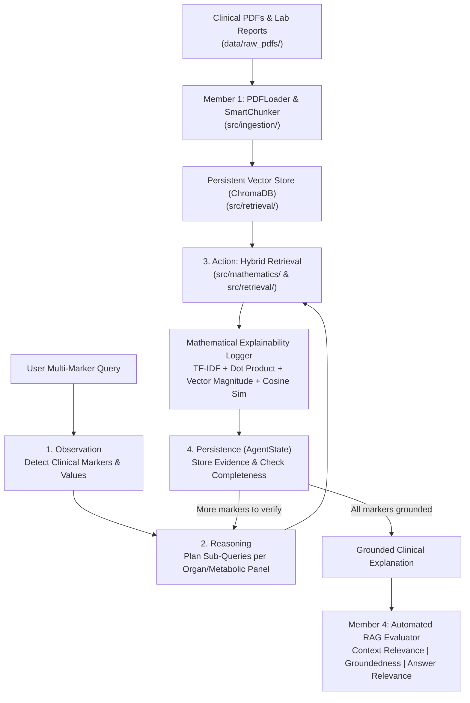

# 🩺 MediExplain AI: Explainable Agentic Medical Lab Report & Guideline Interpreter

**Module:** DS205.3 – Data Science with Python (NSBM Green University)  
**Assessment:** Coursework (40% Weighting)

---

## 1. Problem Statement & Motivation
Patients and non-specialist healthcare workers frequently struggle to interpret laboratory reports containing complex clinical markers (`HbA1c`, `FBS`, `LDL`, `HDL`, `Triglycerides`, `Serum Creatinine`, `eGFR`, `ALT/AST`). While standard Large Language Models (LLMs) generate fluent text, they suffer from hallucinations and operate as opaque "black boxes" without mathematical retrieval justification. Furthermore, multi-condition laboratory panels (e.g., co-existing poorly controlled diabetes and renal impairment) cannot be resolved reliably with a single-shot Naïve RAG lookup.

**MediExplain AI** solves this by implementing an **Explainable Agentic RAG System** that:
1. Grounds every explanation strictly in official clinical practice guidelines (`data/raw_pdfs/`).
2. Exposes foundational retrieval mathematics (**TF-IDF / Bag-of-Words sparse weights**, **Dot Products $\mathbf{q} \cdot \mathbf{d}$**, **Vector Magnitudes $\|\mathbf{v}\|$**, **L2 Normalization**, and **Cosine Similarity**) alongside modern **Dense Embeddings** (`all-MiniLM-L6-v2`).
3. Executes a multi-step **Agentic Loop (`Observation → Reasoning → Action → Persistence`)** to decompose multi-marker queries.
4. Evaluates output quality programmatically across **Context Relevance**, **Groundedness (Faithfulness)**, and **Answer Relevance**.

---

## 2. System Architecture & Data Flow



---

## 3. Modular OOP Structure & Team Module Allocation

```text
Mediexplain-agentic-rag/
├── data/
│   ├── raw_pdfs/                  # Clinical Guidelines & Sample Patient Lab Report PDFs
│   └── sample_chunks.json         # Shared clinical chunks for parallel module testing
├── src/
│   ├── interfaces/
│   │   └── base_interfaces.py     # Abstract Base Classes (ABCs) & Dependency Injection contracts
│   ├── ingestion/                 # [Member 1] PDF parsing (pdfplumber) & Smart Chunking
│   ├── mathematics/               # [Member 2] TF-IDF, Dot Product, Magnitude, Cosine Similarity
│   ├── retrieval/                 # [Member 1 & 2] Persistent ChromaDB & Hybrid Retriever
│   ├── agent/                     # [Member 3] AgentState & Observation-Reasoning-Action Loop
│   └── evaluation/                # [Member 4] Ground-truth dataset & 3 RAG Metrics Evaluator
├── requirements.txt               # Python 3.10+ dependencies
├── .env.example                   # Environment template
└── env.example                    # Environment template (alias)
```

---

## 4. Reproducibility & Setup (Fresh Virtual Environment)

```bash
# 1. Clone the repository
git clone https://github.com/adeeshachathurmina-ux/Mediexplain-agentic-rag.git
cd Mediexplain-agentic-rag

# 2. Create and activate a virtual environment (Python 3.10+)
python -m venv venv
venv\Scripts\activate

# 3. Install dependencies
pip install -r requirements.txt

# 4. Configure environment variables
copy .env.example .env
```
